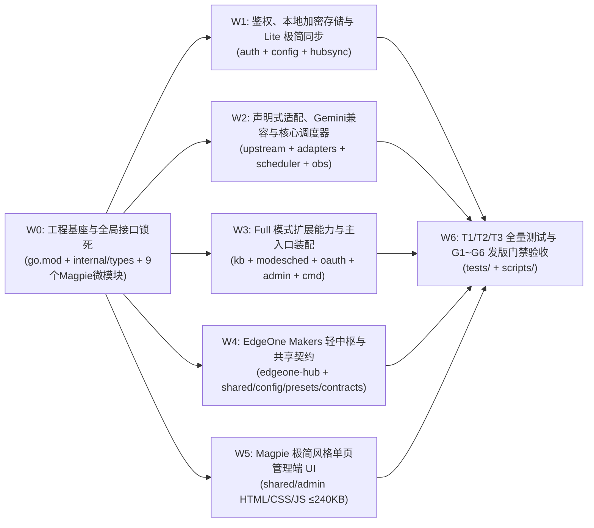

# 多 Agent 协同开发蓝图与全局接口锁死规范 (Multi-Agent Blueprint & Canonical Interfaces)

> **核心目的**：为彻底杜绝多 Agent 并行开发时常见的**“各自发明结构体、JSON 字段名对不上、跨包函数签名冲突、改同一个文件引发合并灾难、集成时推倒重来”**，本文件在开工前将 **1) 全局唯一 Go 核心类型与接口定义（`internal/types/types.go`）**、**2) 1 代兼容 JSON 存储契约**、**3) 多 Agent 物理文件所有权矩阵（零文件重叠）** 一次性 100% 锁死。
> **强制铁律**：
> 1. **主从分工模式**：主 Agent 仅负责整体规划、任务拆解下发与最终统一验收；**所有代码编写与测试验证 100% 由子代理（Subagents，固定使用 `Model: "flash"` 即 Gemini Flash High 档位）完成**。
> 2. **接口锁死**：所有参与协作的子 Agent **必须原封不动导入并使用 `internal/types` 包定义的结构体与接口**，严禁在各自业务包内私自重定义同名配置或跨包契约结构！

---

## 一、 为什么多 Agent 协作容易“来回重构”？本蓝图的四道防呆锁

| 常见多 Agent 翻车原因 | 本蓝图的物理防呆锁 |
|---|---|
| **1. 结构体与 JSON Tag 各写各的**（如 Agent A 写 `KeyID`，Agent B 写 `Label`；或破坏 1 代 `proxy_config.enc` 兼容性） | **防呆锁 1**：下方 §二 直接给出 **`internal/types/types.go` 的完整可编译源码**，所有 JSON 字段名 100% 兼容 1 代 `ocrprox` 与 2 代新增字段，M0 阶段率先落盘锁死。 |
| **2. 跨包调用签名不一致**（如 `hubsync`、`config`、`scheduler`、`adapters`、`obs` 互相猜接口） | **防呆锁 2**：下方 §二 将 6 大核心跨包接口（`ConfigSource`、`AdapterEngine`、`Scheduler`、`ObservabilitySink`、`OAuthManager`、`RouteGuard`）的方法签名全部固定。 |
| **3. 多个 Agent 同时改同一个文件产生冲突** | **防呆锁 3**：下方 §三 划分 **W0 基座 + W1~W6 六个完全正交的并行工作流（Workstreams）**，每个目录/文件有且仅有 1 个 Owner Agent，**零文件写重叠**。 |
| **4. 某个 Agent 偷偷引入被禁用的 Magpie 大泥球或内联样式** | **防呆锁 4**：`CLAUDE.md` 与 `T1` 静态门禁脚本直接拦截任何非白名单依赖、`style=` 内联样式或未在 `readonly.go` 登记的路由。 |

---

## 二、 全局唯一 Go 核心类型与跨包接口定义（`internal/types/types.go` 权威源码规范）

在 **W0（基座初始化）** 阶段，必须将以下定义原样写入 `internal/types/types.go`（零第三方依赖，仅依赖 Go 标准库），后续所有 Agent 直接 `import "github.com/khc8655/llmproxy2/internal/types"`：

```go
package types

import (
	"context"
	"net/http"
	"time"
)

// Role 定义进程运行角色
type Role string

const (
	RoleLite Role = "lite" // NAT VM 极简纯内存节点（Agent Only，零落盘，零管理端）
	RoleFull Role = "full" // 标准 VM 完整节点（Agent + KB，本地 AES-256-GCM 持久化，内嵌 Web 管理端）
	RoleHub  Role = "hub"  // EdgeOne Makers 轻中枢（由 edgeone-hub/ 实现）
)

// RunMode 定义网关当前流量服务模式
type RunMode string

const (
	ModeAgent RunMode = "agent" // 编码/对话代理模式 (/v1/chat/completions, /v1/messages, /v1/responses)
	ModeKB    RunMode = "kb"    // 知识库流水线模式 (/v1/chat/completions[model=chat], /v1/embeddings, /v1/rerank, /v1/ocr)
)

// ProxyConfig 100% 兼容 1 代 proxy_config.enc 与 EdgeOne KV 的顶层配置结构
type ProxyConfig struct {
	Version     int64                       `json:"_version"`
	Providers   map[string]*ProviderConfig  `json:"providers"`
	AgentModels map[string]*AgentModelRoute `json:"agent_models"`
	KBModels    map[string][]*KBCandidate   `json:"kb_models,omitempty"` // key: "chat" | "embedding" | "reranker" | "ocr"
	Settings    RuntimeSettings             `json:"settings"`
	Vault       *VaultClientConfig          `json:"vault,omitempty"` // 仅 Full 模式保存中枢连接配置
}

// ProviderConfig 供应商配置（兼容 1 代字段）
type ProviderConfig struct {
	ID               string            `json:"id,omitempty"`
	Name             string            `json:"name,omitempty"`
	PresetID         string            `json:"preset_id,omitempty"`
	BaseURL          string            `json:"base_url"`
	AnthropicBaseURL string            `json:"anthropic_base_url,omitempty"`
	Enabled          bool              `json:"enabled"`
	Origin           string            `json:"origin,omitempty"` // "vault" (中枢共享) | "local" (仅本端私有，Hub绝不下发)
	RuleHash         string            `json:"rule_hash,omitempty"`
	APIKeys          []*KeyEntry       `json:"api_keys"`
	ModelAliases     map[string]string `json:"model_aliases,omitempty"`
	AdapterRules     *AdapterRules     `json:"adapter_rules,omitempty"`
}

// KeyEntry 单把 API Key 或 OAuth 凭证条目
type KeyEntry struct {
	ID        string     `json:"id,omitempty"`    // 稳定短 ID（如未指定则取 label 或 key 指纹前 8 位）
	Label     string     `json:"label"`           // 1 代兼容标签名（如 "hk-pool-01"）
	Key       string     `json:"key"`             // 明文 API Key 或 OAuth AccessToken（Lite 销毁时需原地清零字节）
	Enabled   bool       `json:"enabled"`
	Origin    string     `json:"origin,omitempty"`    // "vault" | "local"
	AuthType  string     `json:"auth_type,omitempty"` // "api_key" (默认) | "oauth_device"
	OAuthMeta *OAuthMeta `json:"oauth_meta,omitempty"`
}

// OAuthMeta MiniMax Code Plan 等 OAuth 2.0 刷新元数据（仅 Full 模式持久化）
type OAuthMeta struct {
	Provider     string `json:"provider"` // e.g. "minimax"
	RefreshToken string `json:"refresh_token,omitempty"`
	ExpiresAt    int64  `json:"expires_at"` // Unix 秒
	ClientID     string `json:"client_id,omitempty"`
}

// AgentModelRoute Agent 模式下的模型路由绑定（100% 兼容 1 代 agent_models）
type AgentModelRoute struct {
	Enabled         bool              `json:"enabled"`
	ActiveKey       string            `json:"active_key,omitempty"`       // 格式: "{provider}:{key_label}"（sticky_failover 首选粘性 Key）
	RoutingStrategy string            `json:"routing_strategy,omitempty"` // 覆盖全局: "sticky_failover" | "round_robin" | "manual"
	Candidates      []*RouteCandidate `json:"candidates"`
}

// RouteCandidate 模型候选池条目
type RouteCandidate struct {
	Provider    string `json:"provider"`
	KeyLabel    string `json:"key_label"`              // 对应 KeyEntry.Label
	TargetModel string `json:"target_model,omitempty"` // 显式指定上游真实模型名（为空则走 ModelAliases 或原名）
	Enabled     bool   `json:"enabled"`
	Weight      int    `json:"weight,omitempty"`
}

// KBCandidate 知识库模式四分类（chat / embedding / reranker / ocr）候选条目
type KBCandidate struct {
	Provider string `json:"provider"`
	Model    string `json:"model"`
	KeyLabel string `json:"key_label,omitempty"`
	Enabled  bool   `json:"enabled"`
	MaxRPM   int    `json:"max_rpm,omitempty"`
	MaxConc  int    `json:"max_concurrency,omitempty"`
}

// RuntimeSettings 与 shared/config/settings.schema.json 一一对齐的规范化设置项
type RuntimeSettings struct {
	RunMode                     RunMode `json:"run_mode"`                        // "agent" | "kb"
	AgentRoutingStrategy        string  `json:"agent_routing_strategy"`          // "sticky_failover" | "round_robin" | "manual"
	AgentFirstByteTimeoutSec    int     `json:"agent_first_byte_timeout_sec"`    // 默认 120
	CooldownRateLimitSec        int     `json:"cooldown_rate_limit_sec"`         // 429 模型级冷却秒数，默认 15
	CooldownServerErrorSec      int     `json:"cooldown_server_error_sec"`       // 5xx 模型级冷却秒数，默认 30
	CooldownNetworkErrorSec     int     `json:"cooldown_network_error_sec"`      // 网络超时冷却秒数，默认 15
	CooldownAuthErrorSec        int     `json:"cooldown_auth_error_sec"`         // 401/402/403 Key 级冷却秒数，默认 86400 (24h)
	OCRMaxInflight              int     `json:"ocr_max_inflight"`                // KB OCR 预读信号量上限，默认 4
	KBGlobalMaxConcurrency      int     `json:"kb_global_max_concurrency"`       // KB 全局并发上限，默认 16
	ModeScheduleEnabled         bool    `json:"mode_schedule_enabled"`           // 是否开启时段自动切换
	ModeScheduleAgentWindow     string  `json:"mode_schedule_agent_window"`      // 如 "08:30-22:30"
	ModeScheduleTimezone        string  `json:"mode_schedule_timezone"`          // 如 "Asia/Shanghai"
	ModeScheduleWebhookURL      string  `json:"mode_schedule_webhook_url,omitempty"`
	ModeScheduleWebhookSecret   string  `json:"mode_schedule_webhook_secret,omitempty"`
}

// VaultClientConfig Full 节点连接 EdgeOne Hub 的客户端配置
type VaultClientConfig struct {
	URL       string `json:"url"`
	NodeToken string `json:"node_token,omitempty"`
}

// AdapterRules 声明式适配规则（与 shared/presets/*.json 100% 对应，严禁硬编码 if provider == xxx）
type AdapterRules struct {
	AuthHeader             string            `json:"auth_header,omitempty"`              // 默认 "Authorization"
	AuthPrefix             string            `json:"auth_prefix,omitempty"`              // 默认 "Bearer "
	ExtraHeaders           map[string]string `json:"extra_headers,omitempty"`            // 静态注入头
	StripParams            []string          `json:"strip_params,omitempty"`             // 剥离顶层参数
	RenameParams           map[string]string `json:"rename_params,omitempty"`            // 重命名参数
	OverrideParams         map[string]any    `json:"override_params,omitempty"`          // 强制覆盖参数
	StreamOnly             bool              `json:"stream_only,omitempty"`              // 上游仅支持 stream=true，非流请求需网关聚合成 JSON
	RescueFromText         bool              `json:"rescue_from_text,omitempty"`         // 从文本块挽救 tool_calls
	UnwrapRoot             string            `json:"unwrap_root,omitempty"`              // 解包非标响应外层字段
	StripReasoningEnabled  bool              `json:"strip_reasoning_enabled,omitempty"`  // AMD 等特例剥离字段
	GeminiCompat           bool              `json:"gemini_compat,omitempty"`            // 启用 Gemini 2.5/3.x Thinking/Signature/Schema 兼容层
	ThoughtTagMarker       string            `json:"thought_tag_marker,omitempty"`       // Vertex AI "<thought>" 流式状态机切分标记
	AnthropicStrictSig     bool              `json:"anthropic_strict_signature,omitempty"`
	AnthropicPassbackReq   bool              `json:"anthropic_passback_required,omitempty"`
}

// RuntimeSnapshot 不可变内存快照（由 atomic.Pointer[RuntimeSnapshot] 持有，支持零锁并发读取）
type RuntimeSnapshot struct {
	Config      *ProxyConfig
	ETag        string
	LeaseUntil  time.Time // Lite 模式：当前租约到期时间
	GraceUntil  time.Time // Lite 模式：断网宽限期截止时间
	LoadedAt    time.Time
}

// PurgeSecrets 显式用 0x00 覆写快照内所有明文 API Key 字节（Lite 模式收到 401 或吊销时强制调用）
func (s *RuntimeSnapshot) PurgeSecrets() {
	if s == nil || s.Config == nil {
		return
	}
	for _, p := range s.Config.Providers {
		if p == nil {
			continue
		}
		for _, k := range p.APIKeys {
			if k != nil && k.Key != "" {
				b := []byte(k.Key)
				for i := range b {
					b[i] = 0
				}
				k.Key = ""
			}
		}
	}
}

// ============================================================================
// 跨包标准接口契约（6 大核心接口，连接各 Agent 负责的模块）
// ============================================================================

// 1. ConfigSource 配置源统一接口（由 W2 的 internal/config.LocalSource 与 internal/hubsync.HubSource 分别实现）
type ConfigSource interface {
	// Current 在请求入口处返回最新有效快照；
	// Lite 模式下：首次调用或 now >= LeaseUntil 时通过 singleflight 触发 POST /api/node/config (含 If-None-Match 304 续租)；
	// 若节点被吊销 (401) 或超出 GraceUntil，返回 ErrNodeUnauthorized / ErrSourceUnavailable。
	Current(ctx context.Context, forceRefresh bool) (*RuntimeSnapshot, error)
	// HealthState 返回用于 /healthz 的脱敏状态摘要
	HealthState() (status string, state string, leaseValid bool, configVer int64)
}

// 2. Try & RequestTrace 借鉴自 Magpie trace.go (traceKeep = 60)，记录单次请求的完整多跳故障转移故事
type Try struct {
	Attempt            int    `json:"attempt"`
	Provider           string `json:"provider"`
	KeyID              string `json:"key_id"`
	Model              string `json:"model"`
	Status             int    `json:"status"`
	Millis             int64  `json:"ms"`
	TTFTMillis         int64  `json:"ttft_ms,omitempty"`
	Reason             string `json:"reason,omitempty"` // "rate_limit" | "server_error" | "auth_error" | "network_error" | "client_error"
	CooldownAppliedSec int    `json:"cooldown_applied_sec,omitempty"`
	ErrorSnippet       string `json:"error_snippet,omitempty"` // 经 applog.Scrub 脱敏后的前 240 字节错误摘要
}

type RequestTrace struct {
	ID              string `json:"id"`
	Timestamp       int64  `json:"ts"`
	Mode            string `json:"mode"`     // "agent" | "kb"
	Endpoint        string `json:"endpoint"` // "/v1/chat/completions" | "/v1/messages" | "/v1/ocr" ...
	ReqModel        string `json:"req_model"`
	ServedModel     string `json:"served_model"`
	WinnerProvider  string `json:"winner_provider,omitempty"`
	WinnerKey       string `json:"winner_key,omitempty"`
	Status          int    `json:"status"`
	Stream          bool   `json:"stream"`
	InTokens        int    `json:"in_tokens"`
	OutTokens       int    `json:"out_tokens"`
	CacheReadTokens int    `json:"cache_read_tokens,omitempty"`
	ReasoningTokens int    `json:"reasoning_tokens,omitempty"`
	TTFTMillis      int64  `json:"ttft_ms"`
	TotalMillis     int64  `json:"total_ms"`
	RetriedMillis   int64  `json:"retried_ms,omitempty"`
	Tries           []Try  `json:"tries"`
}

// 3. ObservabilitySink 可观测性统一写入接口（由 W3 的 internal/obs 实现）
type ObservabilitySink interface {
	RecordRequest(trace RequestTrace)
	RecentTraces(onlyFailedOrRetried bool) []RequestTrace
	QueryUsage(period string, tzName string) (map[string]any, error)
}

// 4. AdapterEngine 声明式适配与 Gemini/Anthropic 兼容接口（由 W3 的 internal/adapters 实现）
type AdapterEngine interface {
	PrepareRequest(endpoint string, reqBody []byte, provider *ProviderConfig, targetModel string, clientForcedStream bool) (mutatedBody []byte, extraHeaders map[string]string, upstreamStream bool, err error)
	TransformNonStreamResponse(endpoint string, respBody []byte, provider *ProviderConfig, reqModel string) ([]byte, error)
	WrapStreamTransformer(endpoint string, upstreamReader http.Flusher, provider *ProviderConfig, reqModel string)
}
```

---

## 三、 多 Agent 并行开发分工作流与文件物理所有权矩阵（Zero File Overlap）

为支持你启动多个子 Agent 并行编码且 **0 合并冲突、0 返工**，我们将整个项目拆分为 **1 个前置基座阶段（W0，耗时约 5 分钟）+ 6 个完全可并行推进的独立工作流（W1 ~ W6）**：



### 各 Agent 工作流（Workstream）物理文件边界表（严禁跨界修改他人目录）

| 工作流代号 | 角色定位 | 独占拥有的目录与文件（Write Ownership） | 只读依赖（Read-Only） | 独立验收命令 |
|---|---|---|---|---|
| **W0（前置基座）** | **Foundation & Magpie Green-Zone Porter** | `go.mod`, `internal/types/types.go`, `internal/netguard/`, `internal/steady/`, `internal/lastgood/`, `internal/filelock/`, `internal/filememo/`, `internal/crypto/`, `internal/router/readonly.go`, `internal/upstream/sse.go`, `internal/obs/applog.go` | `/Users/xk/.gemini/antigravity/brain/c10ef9e7-77ff-4771-a90c-06ae3a983920/scratch/magpie` | `go test -race ./internal/netguard/... ./internal/steady/... ./internal/lastgood/... ./internal/filelock/... ./internal/filememo/... ./internal/crypto/... ./internal/router/... ./internal/upstream/... ./internal/obs/...` |
| **W1（配置与同步 Agent）** | **Config, Auth & Lite HubSync Engineer** | `internal/auth/`, `internal/config/`, `internal/hubsync/` | `internal/types`, `internal/crypto`, `internal/steady`, `internal/lastgood`, `internal/filelock` | `go test -race ./internal/auth/... ./internal/config/... ./internal/hubsync/...` |
| **W2（网关内核 Agent）** | **Core Gateway, Adapters, Scheduler & Obs Engineer** | `internal/upstream/transport.go`, `internal/upstream/url.go`, `internal/adapters/`, `internal/scheduler/`, `internal/obs/usage.go`, `internal/obs/trace.go`, `internal/router/middleware.go` | `internal/types`, `internal/netguard`, `internal/upstream/sse.go`, `internal/obs/applog.go`, `/Users/xk/Documents/ocrprox/vm-app/app/{scheduler,proxy_routes,gemini_compat}.py` | `go test -race ./internal/upstream/... ./internal/adapters/... ./internal/scheduler/... ./internal/obs/...` |
| **W3（Full 扩展与装配 Agent）** | **Full Node Extensions (KB/OCR/OAuth/Admin) & Main Assembler** | `internal/kb/`, `internal/modesched/`, `internal/oauth/`, `internal/admin/`, `cmd/llmproxy/main.go` | `internal/types` 及 W1/W2 接口, `/Users/xk/Documents/ocrprox/vm-app/app/{mode_scheduler,oauth_credentials,admin_routes}.py` | `CGO_ENABLED=0 go build ./cmd/llmproxy && go test -race ./internal/kb/... ./internal/modesched/... ./internal/oauth/... ./internal/admin/...` |
| **W4（EdgeOne 中枢与契约 Agent）** | **EdgeOne Hub & Shared Contracts Engineer** | `edgeone-hub/`, `shared/presets/`, `shared/config/`, `shared/contracts/`, `package.json` | `/Users/xk/Documents/ocrprox/{edge-functions,lib,shared}` | `npm run test:t1 && npm run test:hub` |
| **W5（Magpie 极简前端 Agent）** | **Minimalist Web UI Engineer** | `shared/admin/` (`admin.html`, `css/app.css`, `js/*.js`) | [`docs/UI_DESIGN_SPEC.md`](file:///Users/xk/Documents/llmproxy2/docs/UI_DESIGN_SPEC.md), [`docs/ADMIN_UI_BACKEND_CONTRACT.md`](file:///Users/xk/Documents/llmproxy2/docs/ADMIN_UI_BACKEND_CONTRACT.md), `magpie/internal/gui/frontend/src/app.css` | `node tests/t1_contracts/verify_ui_gate.mjs`（0 内联样式、0 抽屉、体积 ≤ 240KB） |
| **W6（QA 与发版门禁 Agent）** | **E2E Verification & Release Gatekeeper** | `tests/`, `scripts/` | 全仓库只读校验 | `npm run verify:release` (G1~G6 全绿) |

---

## 四、 给每个子 Agent 下发任务时的黄金 Prompt 模板（防跑偏 Checklist）

当启动任意子 Agent（W1~W6）时，直接要求其在开始写第一行代码前阅读以下 3 个文件：
1. [`CLAUDE.md`](file:///Users/xk/Documents/llmproxy2/CLAUDE.md)（工程红线与冲突裁决优先级）
2. [`docs/MULTI_AGENT_BLUEPRINT.md`](file:///Users/xk/Documents/llmproxy2/docs/MULTI_AGENT_BLUEPRINT.md)（本文件：`internal/types` 结构锁死与文件物理边界）
3. 对应领域的专项规范：
   - 写 Go 内核与搬运模块必读：[`docs/SYSTEM_DESIGN_SPEC.md`](file:///Users/xk/Documents/llmproxy2/docs/SYSTEM_DESIGN_SPEC.md) + [`docs/MAGPIE_REUSE_MATRIX.md`](file:///Users/xk/Documents/llmproxy2/docs/MAGPIE_REUSE_MATRIX.md)
   - 写前端 UI 必读：[`docs/UI_DESIGN_SPEC.md`](file:///Users/xk/Documents/llmproxy2/docs/UI_DESIGN_SPEC.md) + [`docs/ADMIN_UI_BACKEND_CONTRACT.md`](file:///Users/xk/Documents/llmproxy2/docs/ADMIN_UI_BACKEND_CONTRACT.md)
   - 写安全/测试/发版必读：[`docs/SECURITY_SPEC.md`](file:///Users/xk/Documents/llmproxy2/docs/SECURITY_SPEC.md) + [`docs/TESTING_SPEC.md`](file:///Users/xk/Documents/llmproxy2/docs/TESTING_SPEC.md) + [`docs/RELEASE_SPEC.md`](file:///Users/xk/Documents/llmproxy2/docs/RELEASE_SPEC.md)

### 每个子 Agent 交付前的自检 5 条铁律（Subagent Exit Gate）：
- [ ] **未越界改文件**：`git status` 仅包含本 Workstream 独占目录内的文件；
- [ ] **100% 使用 `internal/types`**：未在包内重复定义 `ProxyConfig`、`ProviderConfig`、`RuntimeSnapshot`、`RequestTrace`；
- [ ] **未引入任何禁用依赖**：`go.mod` 保持 `CGO_ENABLED=0` 纯标准库（无第三方重依赖，无 `magpie` 动态依赖）；
- [ ] **单测带 `-race` 全绿**：本包 `go test -race ./...` 100% 通过且无并发竞争；
- [ ] **UI 零内联样式（仅 W5）**：无 `style="`、无 `.drawer`、总大小 `≤ 240KB`（`245,760 bytes`）。
