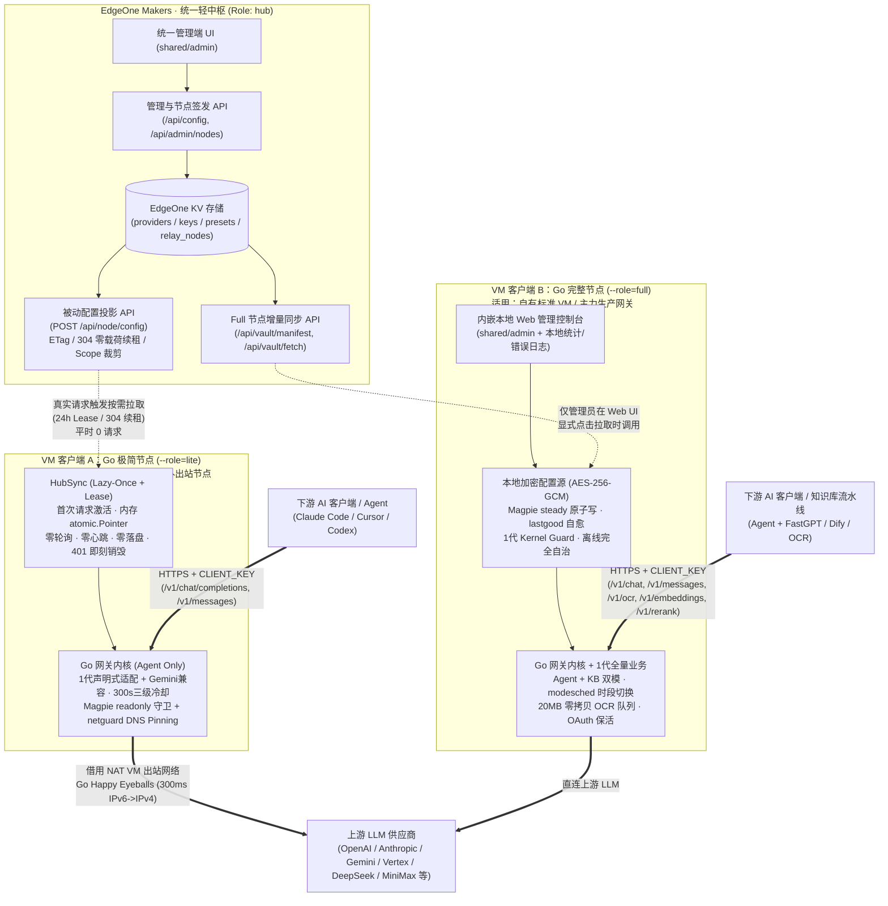

# LLMProxy2 (OCRProxy v2) 系统设计与重构总规范

> **状态**：正式立项基线（v2.0 架构规范 · 经 Magpie 稳定性审计修正版）
> **更新日期**：2026-11-08
> **演进关系**：全面取代前任 Agent 撰写的 v1 初稿，以 **1 代 `ocrprox` 成熟稳定的业务架构为骨架（80%）**，精准鑲嵌 **`yetone/magpie` 经受 734 个版本零缺陷考验的底层标准库微模块（20%）**，同时严防死守隔离 `magpie` 上层高频变动的大泥球代码。

---

## 一、 前任 Agent 设计方案（v1 初稿）与 `magpie` 源码的双重深度复盘

### 1.1 对 `yetone/magpie` 仓库高频更新的实证审查（为什么不能盲目全盘照搬？）

通过拉取 `yetone/magpie` 最近 **1,000 次 Git 提交记录**，我们发现了一个关键事实：
- **仅在 2026-11-01 至 2026-11-08 这 7 天内，`magpie` 就提交了 1,000 次、发布了 734 个版本（`v0.1.2560` → `v0.1.3294`，日均 >100 次更新）！**
- **为什么它天天在改、漏洞频出？**
  统计这 1,000 次提交修改的文件分布后真相大白：
  1. `internal/gui`（7 天 **387 次提交**）与 `internal/provider`（7 天 **252 次提交**）：桌面 UI 微调与 99 家供应商余额/逆向接口变动；
  2. `internal/gateway/gateway.go`（**单文件 10,321 行，7 天改了 109 次！**）、`claude_subscription.go`（7 天 **55 次**）、`fallback.go`（**4,631 行，7 天改 32 次**）、`routing.go`（**2,471 行，7 天改 26 次**）：因为 `magpie` 把逆向白嫖订阅（Claude Code 订阅预热、Kiro IDE、Antigravity、Codex 内部接口、ZCode 试用码 `[1302]`）和各厂商的报错文本判断全部用 `if/else` 硬编码在 1.7 万行的巨型 Go 文件里，直接违背了我们 1 代 `ARCHITECTURE_STANDARDS.md` 的**“声明式适配规则（禁止硬编码 `if provider == xxx`）”**铁律！
  3. 甚至其 `internal/netproxy` 中自定义的 10 秒 HTTP/2 Ping 探活，就在昨天（`v0.1.3256`, commit `970a86ff`）刚因为把慢思考模型 Ping 成 `GOAWAY too_many_pings` 断流而紧急打补丁！
- **那 `magpie` 里什么是真正稳如泰山、可以放心拿来用的？**
  同样在这 1,000 次提交（734 个版本）中，`magpie` 的 **底层纯标准库微模块** 表现出惊人的稳定性：
  - `internal/netguard/netguard.go`（97 行，SSRF 地址判定）：**0 次修改**；
  - `internal/gateway/image_fetch_guard.go`（361 行，DNS Pinning 防 Rebinding 拨号器）：**0 次修改**；
  - `internal/lastgood/lastgood.go`（276 行，防配置损坏内存快照与 `.corrupt` 自愈）：**0 次修改**；
  - `internal/filelock/filelock.go`（116 行，跨进程 OS 文件锁）：**0 次修改**；
  - `internal/filememo/filememo.go`（317 行，按 `mtime+size` 内存缓存）：**0 次修改**；
  - `internal/steady/steady.go`（225 行，原子文件写盘）：**仅 1 次小优化**；
  - `internal/backup` 中的 `PBKDF2-SHA256 + AES-256-GCM` 标准库加解密（~100 行）：**0 次修改**；
  - `internal/gateway/readonly.go`（108 行，只读路由白名单守卫 + `routeMux` 门禁）：**核心逻辑 0 次修改**；
  - `internal/gateway/sse.go`（148 行，SSE 流扫描器）：**仅 1 次修改**；
  - `internal/gateway/gemini_schema.go`（336 行，Gemini JSON Schema 递归清洗）：**仅 1 次修改**。

### 1.2 前任 Agent 方案（v1 初稿）的五大缺陷与本方案的修正

| 序号 | 前任方案（v1 初稿）的缺陷 | 本方案（v2 正式版）的精准修正 |
|---|---|---|
| **缺陷 1：没有对 `magpie` 做变更频率审计，复用边界模糊** | 前任方案只口头提了 4 个点，既没给出具体代码搬运清单，也没识别出 `magpie` 哪些包是冻结稳定的、哪些包是日更百次的泥潭。 | 建立严格的 **《Magpie 稳定性审计与白名单复用矩阵》**（[`docs/MAGPIE_REUSE_MATRIX.md`](file:///Users/xk/Documents/llmproxy2/docs/MAGPIE_REUSE_MATRIX.md)）：**只搬运上述 734 版本 0 缺陷的 ~1,650 行纯标准库微模块**，物理隔绝 `gateway.go` / `routing.go` / `netproxy` 等高频变动代码。 |
| **缺陷 2：把 1 代已稳定支持的 Google / Vertex / AMD 阉割进 `unsupported[]`** | 前任方案 §4 宣布放弃 `google` / `vertex` / `amd` 的 Schema 清洗、Thinking 矩阵与 Messages 重排，列入 `unsupported[]` 直接报错。 | 1 代 `vm-app/app/gemini_compat.py`（仅 374 行）与 `proxy_routes.py` 的声明式规则引擎（~350 行）早已在生产环境稳定运行！将其 1:1 干净转译为 Go（`internal/adapters/`）并结合 `magpie` 稳定的 `gemini_schema.go`，**第一天即 100% 完整支持全部 16 家厂商预设，彻底废除 `unsupported[]`！** |
| **缺陷 3：忽视 NAT VM 的双栈与 IPv6 出站黑洞问题** | 前任方案未设计双栈监听与出站 IPv6 黑洞回退。 | 1. **入站**：移植 1 代 `run_server.py` 的 `IPV6_V6ONLY=0` 单 Socket 双栈监听；<br>2. **出站**：使用 **Go 标准库原生 `net.Dialer{FallbackDelay: 300ms}` (RFC 6555 Happy Eyeballs)** 配合 `netguard` 多 IP Pinning 回退，遇到 NAT 小鸡 IPv6 黑洞 300ms 自动切 IPv4，既快又无 `netproxy` 自定义 Ping 的断流隐患。 |
| **缺陷 4：遗漏 1 代多项核心生产特性** | 漏掉了 1 代的 MiniMax OAuth Device Flow、流式首包 Peek 防空回/流内错误检测、OCR 预读入场信号量（防 20MB OOM）、Kernel Guard（防掩码 `●` 覆盖真实密钥）。 | 将 1 代全部 17 个 Python 模块的能力逐项 1:1 映射到 Go 包，并从 `magpie` 吸收 `forbiddenAlike`（连续两把 Key 报完全相同的 400/403 客户端错误时不误封第一把 Key，仅 30 行干净代码）强化 1 代调度器。 |
| **缺陷 5：困在 1 代仓库原位改造思维，缺乏新项目规范** | 仍在讨论与 `vm-app/` 共存，未建立独立新仓库规范。 | 在 `/Users/xk/Documents/llmproxy2` 从零建立标准工程目录树与全套规范文档（设计、复用审计、安全、契约、T1~T3 测试、G1~G6 发版门禁、运维手册）。 |

---

## 二、 总体架构设计（EdgeOne 轻中枢 + 两类 Go 客户端）

### 2.1 核心拓扑与职责划分



### 2.2 三种运行角色能力矩阵

同一个 Go 静态二进制（`llmproxy`），通过 `--role=lite|full`（或环境变量 `LLMPROXY_ROLE=lite|full`）切换角色；EdgeOne Makers 运行 `hub` 角色：

| 能力维度 | `hub`（EdgeOne Makers 轻中枢） | `lite`（Go 极简 NAT 客户端） | `full`（Go 完整标准客户端） |
|---|---|---|---|
| **核心定位** | K（供应商/密钥/规则）集中维护 + VM 节点签发与注销 | 借用受限/不可信 NAT VM 网络做纯内存安全出站中转 | 自有服务器全功能 AI 网关（100% 替代 1 代 Python VM） |
| **客户端 `/v1/*` 流量代理** | **✗ 彻底移除**（0 推理流量经过 EdgeOne） | **✓ Agent 模式**（`/v1/chat/completions`, `/v1/messages`, `/v1/models`） | **✓ Agent + KB 双模式**（含 `/v1/ocr`, `/v1/embeddings`, `/v1/rerank`） |
| **厂商适配与 Gemini/Vertex 支持** | 仅存储规则与预设 | **✓ 全支持**（1 代声明式 `adapter_rules` + `gemini_compat` Go 移植，无 `unsupported[]`） | **✓ 全支持**（与 `lite` 共享同一套 `internal/adapters` 引擎） |
| **配置与密钥存储位置** | EdgeOne KV | **纯内存（`atomic.Pointer[Snapshot]`），严禁落盘** | 本地 `PBKDF2 + AES-256-GCM` 加密文件（`proxy_config.enc`） |
| **与 EdgeOne 中枢通信方式** | 被动响应 HTTP 请求 | **Lazy-Once + Lease**：首个真实客户端请求触发拉取，租约期内 0 请求，到期 `If-None-Match` 304 续租 | **仅管理员显式触发**：在本地 Web UI 点击“从中枢拉取/同步”时调用 |
| **定时轮询 / 定时心跳** | **✗ 零轮询、零心跳、不主动连 VM** | **✗ 零定时器**（无流量时中枢请求数为 0） | **✗ 零定时器** |
| **中枢断网或故障时行为** | — | 租约期内继续用内存 `lastgood` 服务；租约+宽限期耗尽仍失联则**自动清空内存并停服（503）** | **100% 离线继续服务**，不受任何影响 |
| **节点被中枢注销/吊销（401）** | 将 `relay_nodes[id].enabled=false` | 下次条件拉取（或上游 401 触发提前刷新）收到 401 **立即清空内存 Key 并停服** | 仅拒绝继续从中枢拉取新 Key，不影响本地已有服务 |
| **本地 Web 管理端与写接口** | **✓ 中枢管理控制台**（含 Vault 与节点签发页） | **✗ 物理移除**（不挂载 `admin` 路由，叠加 Magpie `readonly.go` 守卫，仅保留脱敏 `/healthz`） | **✓ 完整本地管理控制台**（含供应商/模型/KB/时段/OAuth/错误日志） |
| **OAuth 2.0 凭证（如 MiniMax）** | 可选存储或由节点管理 | 可接收中枢下发的有效 Bearer Token | **✓ 完整支持** Device Flow 扫码/验证码登录、6h 自动保活刷新与落盘 |
| **内存占用基线（空载 / 峰值）** | Serverless 按次计费 | **~12MB / < 30MB**（64MB NAT 小鸡稳定运行） | **~18MB / < 60MB**（含 20MB 零拷贝流式 OCR 缓冲控制） |

---

## 三、 EdgeOne Makers 轻中枢设计（K 维护 + 节点签发与注销）

### 3.1 EdgeOne 瘦身清单（存留与移除）

- **彻底移除**：
  - 删除 1 代 `edge-functions/v1/*`（`models.js`、`chat/completions.js`、`messages.js`）及 `cloud-functions/v1.py` 全部推理代理代码；
  - 删除 `lib/cooldowns.js`、`lib/normalize.js`、`lib/nodestats.js`、`api/test.js`（仅保留管理员添加 Key 时的单次连通性校验 `verify-key.js`）；
  - 删除 `PROXY_API_KEY` 与客户端推理鉴权。
- **核心保留与升级**：
  1. **Vault K 维护**：保留供应商、API Key（区分 `origin: "vault"` 可下发与 `origin: "local"` 仅中枢自留）、`agent_models` 绑定、预设库 `lib/presets/*` 与 `api/config` 乐观锁（`_version` CAS）读写。
  2. **VM 节点签发与注销管理（新增 `/api/admin/nodes`）**：
     - **签发（Issue）**：管理员在 EdgeOne 控制台点击「新建节点」，指定节点名称、角色（`lite` / `full`）、租约时长（`lease_ttl`，默认 `86400` 秒即 24h，可设 `3600` 秒即 1h）、宽限期（`grace_ttl`，默认 `3600` 秒）以及 **权限范围（`scope`）**：
       - `scope.models`：允许该节点服务的模型白名单（如 `["*"]` 或 `["claude-sonnet-4-20250514", "deepseek-chat"]`）；
       - `scope.providers`：允许该节点使用的供应商与指定 Key 标签白名单（实现不同 NAT 节点分配不同 Key 池，防单台不可信小鸡拿到全量家底）。
     - 中枢生成高熵令牌 `NODE_TOKEN`（格式：`stk_node_<48位hex随机数>`，24 字节真随机），**明文仅在签发弹窗显示一次**；KV 中仅存储 `token_sha256`（`sha256(NODE_TOKEN)`）。
     - **注销/吊销（Revoke）与删除**：管理员随时一键切换 `enabled: false`（吊销）或彻底删除节点记录，并支持一键轮换（Rotate）节点 Token。
  3. **被动配置投影接口（新增 `POST /api/node/config`）**：
     - 供 `lite` 节点（以及 `full` 节点）凭 `Authorization: Bearer <NODE_TOKEN>` 按需拉取配置。

### 3.2 极简模式通信状态机：`Lazy-Once + Lease + 304 续租 + 智能防抖刷新`

```text
[Go Lite 节点启动]
  ├─ 设置 RLIMIT_CORE = 0（禁 Core Dump），初始化 netguard Pinning Transport 与只读路由守卫
  ├─ 内存 Snapshot = nil（不发任何网络请求连 EdgeOne！）
  └─ GET /healthz 返回 {"status": "standby", "state": "waiting_first_request", "lease_valid": false}
         │
         ▼
[第 1 个携带有效 CLIENT_KEY 的真实客户端请求到达]
  ├─ singleflight.Group 合并并发首次激活（防止瞬间 10 个并发请求触发 10 次拉取）
  └─ 调用 EdgeOne: POST /api/node/config (Authorization: Bearer <NODE_TOKEN>)
         ├─ HTTP 200 OK:
         │    ├─ 校验 payload，构建内存 RuntimeSnapshot（含内存 Key、路由表、预设规则）
         │    ├─ atomic.Pointer.Store(snapshot)，记录 etag 与 lease_until / grace_until
         │    └─ 立即转发当前客户端请求至上游 LLM
         ├─ HTTP 401 / 403 (Token 无效或节点已注销):
         │    ├─ 标记 state = "revoked"，内存 Snapshot 置 nil
         │    └─ 返回客户端 503 Service Unavailable (Node not authorized)
         └─ 网络超时 / 5xx:
              └─ 不缓存，带退避冷却（如 10s）后允许下一次真实请求重试，当前请求返回 503
         │
         ▼
[租约期内（now < lease_until）的后续千万次客户端请求]
  ├─ 直接无锁读取 atomic.Pointer[RuntimeSnapshot]
  ├─ 对 EdgeOne 发起 0 次请求！
  └─ 【异常加速机制】若某次请求在尝试完候选 Key 后均遭遇上游 401/403（疑似 Key 在上游被封或中枢已换 Key）：
       └─ 若距离上次拉取中枢已超过 min_refresh_interval（默认 5 分钟，防抖）：
            └─ singleflight 触发一次带 If-None-Match 的提前刷新，及时拉取新 Key 或感知节点吊销
         │
         ▼
[租约到期后（now >= lease_until）的第 1 个真实客户端请求]
  └─ singleflight 携带 If-None-Match: "<etag>" 调用 POST /api/node/config
         ├─ HTTP 304 Not Modified（配置未变，常态占 99%）:
         │    ├─ 响应无 Body（0 字节载荷，省流量省 CPU），仅从响应头读取新 X-Lease-Until
         │    └─ 原地延长当前内存 Snapshot 的 lease_until，继续零拷贝转发
         ├─ HTTP 200 OK（中枢改了 Key 或规则）:
         │    ├─ 构建新 RuntimeSnapshot 并原子替换，清零旧 Snapshot 中的 Key 切片
         │    └─ 用新配置转发请求
         ├─ HTTP 401 / 403（管理员在中枢注销了该节点！）:
         │    ├─ 立即执行 PurgeMemory()：显式用 0x00 覆写旧 Key 字节切片，atomic.Pointer.Store(nil)
         │    └─ 置 state = "revoked"，后续请求立即返回 503
         └─ 网络错误（EdgeOne 临时不可达）:
              ├─ 若 now < grace_until（处于宽限期内）：保留 lastgood 内存快照继续服务，但保持 stale 标记
              └─ 若 now >= grace_until（宽限期耗尽）：执行 PurgeMemory() 清空内存并停服（返回 503）
```

---

## 四、 Go 二进制内部架构（20% Magpie 冻结级基石 + 80% 1 代成熟业务移植）

```text
cmd/llmproxy/main.go               入口：解析 --role=lite|full，设置 RLIMIT_CORE=0，装配双栈 Listener
internal/
  types/
    types.go                       [多 Agent 协作锁死基石] 全局唯一结构体 (ProxyConfig/RuntimeSnapshot/RequestTrace) 与 6 大跨包接口
  netguard/                        [搬运自 Magpie · 734版本0修改] SSRF 地址判定 + DNS Pinning 防 Rebinding 拨号器
  steady/                          [搬运自 Magpie · 734版本1修改] Full 模式跨平台原子写文件 (Temp+Chmod+Fsync+Rename)
  lastgood/                        [搬运自 Magpie · 734版本0修改] 配置防损坏内存快照与 .corrupt 备份自愈
  filelock/                        [搬运自 Magpie · 734版本0修改] 跨进程 OS 文件锁 (syscall.Flock)
  filememo/                        [搬运自 Magpie · 734版本0修改] 基于 mtime+size 的文件解析内存缓存
  crypto/                          [搬运自 Magpie · 734版本0修改] 标准库 PBKDF2-SHA256 + AES-256-GCM + 1代 Fernet 兼容解密
  router/
    readonly.go                    [搬运自 Magpie · 734版本0逻辑修改] Lite 模式只读路由白名单守卫 + routeMux 测试门禁
    middleware.go                  [移植自 1代 middleware.py] 安全响应头 + 仅 /v1* 开启 CORS
  upstream/
    sse.go                         [搬运自 Magpie · 734版本1修改] SSE 流式扫描器、裸错误 JSON 识别、: keep-alive 保活
    transport.go                   [Go 标准库原生] RFC 6555 Happy Eyeballs (300ms IPv6->IPv4 自动回退) + netguard 集成
    url.go                         [移植自 1代 upstream.py] JoinUpstream 与 BuildMessagesUpstream
  auth/                            [融合 Magpie access + 1代 auth.py] SHA-256 常量时间比对、CLIENT_KEY 全来源强制、IP 防爆破
  config/                          [移植自 1代 config_store.py] LocalSource (Full 加密持久化 + Kernel Guard 防 ● 覆盖 + CAS 409)
  hubsync/                         [2代核心新增] HubSource (Lite 按需 Lazy-Once + Lease + ETag 304 续租 + 401 PurgeMemory)
  adapters/                        [1:1 移植自 1代 proxy_routes.py + gemini_compat.py + Magpie gemini_schema.go]
    rules.go                       16 家厂商声明式 adapter_rules 流水线 (stream_only 聚合、rescue_from_text、unwrap_root 等)
    gemini.go                      Gemini 2.5/3.x Thinking 矩阵、<thought> 流式拆分、{id}:::{sig} 签名保持、Schema 递归清洗
  scheduler/                       [1:1 移植自 1代 scheduler.py + 吸收 Magpie forbiddenAlike 与多路会话粘性思想]
    scheduler.go                   300s 硬预算、sticky_failover / round_robin / manual（含全局策略继承）、单 Key 信号量与滑动窗口 RPM
    session_sticky.go              按请求头 / prompt_cache_key / metadata / Prompt 前缀哈希提取会话键的多路并发粘性缓存（15m 滑动 TTL + LRU）
    cooldown.go                    三级冷却 (模型级 / Key级 24h / 410 Gone) + key_bans.json + forbiddenAlike 双Key同错免误封
    peek.go                        流式首包 _peek_until_payload (拦截 200 流内错误与空流) + 45s 预提交保活
  kb/                              [1:1 移植自 1代 proxy_routes.py (Full 专属)] 预读信号量 + 20MB 零拷贝分片流式 OCR + Emb/Rerank
  modesched/                       [1:1 移植自 1代 mode_scheduler.py (Full 专属)] 时段自动切换 + 活跃请求优雅排空 + Webhook
  oauth/                           [1:1 移植自 1代 oauth_credentials.py (Full 专属)] MiniMax Device Flow + PKCE + 6h 保活
  obs/                             [全面借鉴 Magpie 三层轻量可观测体系，彻底取代 1代 stats.py & agent_metrics.py]
    applog.go                      [搬运自 Magpie · 734版本0修改] 20行内置 scrub 密钥脱敏 + Full 模式 5MB 双文件自轮转 (Lite 仅挂 stderr)
    usage.go                       [借鉴自 Magpie usage.jsonl] 单句柄追加写 Token/延迟流水账本 + 按 today/7d/30d 与时区聚合
    trace.go                       [借鉴自 Magpie trace.go] traceKeep=60 内存环形缓冲区，完整记录单请求内 Tries[] 多跳故障转移轨迹
  admin/                           [移植自 1代 admin_routes.py (Full 专属)] 管理 API、Vault 客户端、内嵌 shared/admin 静态产物
```

---

## 五、 分阶段实施路线图（M0 ~ M5）

| 里程碑 | 交付目标 | 关键动作与复用落点 | 验收标准 |
|---|---|---|---|
| **M0：工程基建、全局类型锁死与 Magpie 冻结级微模块搬运** | 建立 `llmproxy2` 目录骨架、`go.mod`、`internal/types/types.go`，搬运 9 个零变更记录的 Magpie 标准库微模块 | 落盘 `internal/types` 全局接口（见 [`docs/MULTI_AGENT_BLUEPRINT.md`](file:///Users/xk/Documents/llmproxy2/docs/MULTI_AGENT_BLUEPRINT.md)），搬运 `netguard`、`steady`、`lastgood`、`filelock`、`filememo`、`crypto`、`readonly.go`、`sse.go`、`applog.go` 并跑通 `go test -race` | 基础包单测 100% 全绿，`CGO_ENABLED=0` 静态编译通过，解锁 W1~W5 多 Agent 并行开发 |
| **M1：共享契约与 EdgeOne Makers 轻中枢** | 迁移 `shared/`（presets/config/admin），实现 EdgeOne 轻中枢（删 `/v1/*`，增 `/api/admin/nodes` 与 `POST /api/node/config`） | 扩展 `HOST.capabilities` 支持 `hub/lite/full`；实现节点 Token 签发、Scope 投影缓存、ETag/304 续租与一键注销 | 契约测试 T1 全绿；模拟节点验证 200/304/401、Scope 隔离与 `origin=local` 物理阻断 |
| **M2：Go Lite 极简模式（NAT VM 节点）** | 交付 `--role=lite` 完整可用二进制 | 实现 `hubsync`（Lazy-Once + Lease）+ 1 代 `adapters`（含 `gemini_compat`）与 `scheduler`（含 `forbiddenAlike`）的 Go 移植 + 双栈监听 | 在 64MB/128MB NAT 测试 VM 上：① 1000 次请求仅触发 1 次中枢调用；② 全盘/内存/日志扫描 0 明文 Key 落盘；③ 中枢注销后立即 401 清空内存停服；④ Gemini/Vertex/Anthropic/OpenAI 全协议通过 |
| **M3：Go Full 完整模式（Agent + 管理端 + OAuth）** | 交付 `--role=full` 的 Agent 生产能力与内嵌 Web 控制台 | 接入本地 AES-256-GCM 配置存储（兼容 1 代 Fernet）、内嵌 `shared/admin`、实现 `/api/admin/*`、Vault 手动拉取、MiniMax OAuth Device Flow | 断网离线 100% 可用；管理端 UI 全部操作与 1 代行为一致；Kernel Guard 防掩码覆盖测试通过 |
| **M4：Go Full 知识库模式（KB + 零拷贝 OCR + 时段调度）** | 补齐 `kb` 模式全部特性 | 实现 `internal/kb`（预读信号量 + 20MB 零拷贝分片流式 OCR + Embeddings + Rerank）与 `internal/modesched` 时段自动切换 | 并发 20MB OCR 压测内存平稳不 OOM；时段切换优雅排空与 Webhook 回归通过 |
| **M5：全量门禁闭环与发版就绪** | G1~G6 六道自动化门禁与一键部署脚本 `install.sh` | 完成多架构交叉编译脚本、systemd 只读加固模板与全量 E2E 回归网 | `npm run verify:release` 与 `go test -race ./...` 100% 全绿 |
